# TrendPulse Drop & DM Closing Funnel — Architecture Specification

> **Target Market:** Solo Indian Instagram Thrift Curators, Vintage Boutiques, and Social Apparel Resellers.  
> **Core Value Proposition:** Eliminates buyer ghosting with 10-minute atomic locks, enables zero-custody direct P2P UPI payments, and automates courier/supplier fulfillment with a streamlined **Ship-Now Only** model.

---

## 1. High-Level Funnel Diagram

```mermaid
flowchart TD
    subgraph Layer1["1. Organic Instagram Discovery"]
        Reel["Instagram Reel / Story Drop\n(10-15 curated items showcase)"] --> CTA["Caption / Story Sticker:\n'Tap link in bio to claim' or DM 'DROP'"]
        CTA --> BioLink["1 Single Drop Link:\ntrendpulse.live/drop/winter-vintage"]
    end

    subgraph Layer2["2. Buyer In-App Mobile Funnel (Zero Login)"]
        BioLink --> MobileFeed["Instagram In-App Browser Loads (<1s)\n• Visual Item Grid\n• Sizing (Chest, Length in inches)\n• Live Status: Available / Reserved / Sold"]
        MobileFeed --> Claim["Buyer taps 'CLAIM' on an item"]
        Claim --> Timer["10-MINUTE ATOMIC LOCK STARTS\nItem reserved exclusively for this buyer.\nAuto-releases if timer hits 00:00!"]
        Timer --> AddressForm["Pincode-Validated Address Form\n• Name & WhatsApp Number\n• 6-digit Pincode (Auto-fills City/State)\n• House / Street Address"]
        AddressForm --> OrderSummary["Order Calculation\nItem Price + Flat Shipping Fee (₹70) = Total"]
    end

    subgraph Layer3["3. Zero-Custody UPI Payment Handshake"]
        OrderSummary --> UPIClick["Buyer taps 'Pay via UPI'"]
        UPIClick --> UPIIntent["Direct Phone UPI Deep-Link\nupi://pay?pa=seller@upi&am=total&pn=StoreName"]
        UPIIntent --> NativeApp["Native GPay / PhonePe / Paytm Opens\n(Direct P2P: 100% money goes to seller instantly)"]
        NativeApp --> UTRScreen["Buyer returns to browser\nEnters 12-digit UTR Reference"]
        UTRScreen --> LockSold["Item Permanently Marked SOLD\nOrder status: 'Pending Verification'"]
    end

    subgraph Layer4["4. Seller Operations Dashboard (Mobile Web / PWA)"]
        LockSold --> SellerDash["Seller Phone Notification:\n'New Order #104 from @ananya (UTR: 9812...)'"]
        SellerDash --> Verify["Seller cross-checks GPay notification & taps 'Verify'"]
        Verify --> Routing{"Fulfillment Mode"}
        
        Routing -->|Stockist / Holds Stock| StockistFlow["1-Click Shiprocket / Delhivery CSV Export\n(Direct bulk courier booking)"]
        Routing -->|Reseller / Zero Stock| ResellerFlow["1-Click 'Forward to Supplier on WhatsApp'\n(Pre-fills complete customer address in 1 tap)"]
    end

    subgraph Layer5["5. Sourcing Intelligence (Data Engine Integration)"]
        StockistFlow --> Intel["Live Sales Data Engine"]
        ResellerFlow --> Intel
        Intel --> SourcingReport["'What to Thrift Next' Sourcing Card\n• Aesthetic Sell-Through Speed (e.g., Y2K: 14m)\n• Top Demanded Sizes (e.g., Size L, Chest 42)\n• Actionable Procurement Advice for the Weekend"]
    end
```



---

## 2. The 5 Operational Layers

### Layer 1: Natural Instagram Discovery
* **Goal:** Drive organic viral reel viewers into a structured drop without manual DM answering.
* **Mechanism:**
  * Seller records a Reel showing a haul of 10–20 pieces.
  * Captions & sticker CTA: *"Drop is LIVE! All pieces with chest/length measurements are at the link in bio (or comment 'DROP')."*
  * Seller lists all pieces on TrendPulse in under 3 minutes before posting.

---

### Layer 2: Buyer In-App Mobile Funnel (Ship-Now Direct Checkout)
* **Goal:** Eliminate cart abandonment, ghosting, and confusing multi-week holds.
* **Key Specifications:**
  * **Zero-Auth Guest Checkout:** No email, no password, no social logins. Identifiers are strictly Instagram Handle + WhatsApp Number.
  * **10-Minute Atomic Lock:** Prevents double-booking and ghosting. If unpaid after 10 minutes, the item auto-releases.
  * **Pincode Validator:** Entering the 6-digit Indian PIN auto-resolves City and State, preventing courier RTO penalties.
  * **Flat Shipping Rate:** Transparent ₹70 delivery fee automatically calculated at checkout (`Total = Item Price + ₹70`).

---

### Layer 3: Zero-Custody UPI Payment Handshake
* **Goal:** Complete trust, zero merchant fees, zero RBI compliance overhead.
* **Technical Flow:**
  1. Frontend constructs deep link:
     ```text
     upi://pay?pa={seller_upi_id}&pn={store_name}&am={total_amount}&cu=INR&tn=Order_{item_id}
     ```
  2. Mobile OS launches installed UPI apps (Google Pay, PhonePe, Paytm).
  3. Money transfers **directly from buyer's account to seller's account**. TrendPulse touches ₹0.
  4. On return to browser, buyer inputs the **12-digit UTR/UPI reference**.

---

### Layer 4: Seller Operations & Split Fulfillment

```
                     Order Arrives (₹1,369 Paid via UPI)
                                     │
                     Seller Fulfillment Setting
                                     │
             ┌───────────────────────┴───────────────────────┐
             ▼                                               ▼
    [STOCKIST / CURATOR]                            [RESELLER / DROPSHIPPER]
    "I pack and ship myself"                        "My supplier ships it"
             │                                               │
             ▼                                               ▼
    • 1-Click Shiprocket / Delhivery CSV            • 1-Click "Forward to Supplier on WhatsApp"
    • Direct label download                         • Auto-formatted WhatsApp address text
    • Verified dispatch within 24-48h               • 0 manual copy-pasting
```

#### For Stockists:
* **1-Click Shiprocket CSV Export:** Validated fields (Name, Phone, Address, City, State, Pincode, Item Name) ready for bulk courier upload.

#### For Resellers:
* **1-Click WhatsApp Forward:** Generates a `https://wa.me/{supplier_phone}?text=...` URL pre-filled with:
  > *"Bhai, new order for Item #104 (Vintage Oversized Tee - Black L).*  
  > *Ship to: Rahul Kumar | 9876543210*  
  > *Flat 402, Tonk Road, Jaipur - 302020*  
  > *Please confirm dispatch & send tracking."*

---

### Layer 5: Sourcing Intelligence Loop (Data Engine Hook)
* **Goal:** Tell the seller what to source next weekend based on real clearance speeds.
* **Integration:**
  * Uses existing `data_engine/social_curation/aesthetics.py` to auto-tag garments (Y2K, Grunge, Gorpcore, Streetwear).
  * Uses `data_engine/social_curation/thrift_sourcing.py` to calculate sell-through velocity per aesthetic and size.
  * Outputs the weekly **"Procurement Hunt Card"**:
    > *"Your Y2K Corsets sold out in 14 minutes at ₹899, while Cargo Pants took 4 days. Prioritize: Y2K Corsets and Vintage 90s Tees in Size L for this weekend's sourcing run."*

---

## 3. State Machines

### Item State Machine
```text
 [AVAILABLE]
     │
     │  Buyer clicks "CLAIM"
     ▼
 [RESERVED]  ──(10-min timer expires)──>  [AVAILABLE]
     │
     │  Buyer submits UTR
     ▼
 [PENDING_VERIFICATION]
     │
     │  Seller confirms payment
     ▼
 [SOLD / READY_FOR_DISPATCH]
```

### Order State Machine
```text
 [CLAIMED] ──> [PENDING_UTR] ──> [PAYMENT_VERIFIED] ──> [DISPATCHED]
```

---

## 4. Database Schema Blueprint

```
┌────────────────────────────────────────┐
│                 Store                  │
├────────────────────────────────────────┤
│ id: Integer (PK)                       │
│ user_id: Integer (FK -> User)          │
│ name: String(255)                      │
│ slug: String(100) (Unique, indexed)    │
│ instagram_handle: String(100)          │
│ upi_id: String(100)                    │
│ phone: String(20)                      │
│ fulfillment_type: Enum(self, supplier) │
│ supplier_phone: String(20) (Nullable)  │
│ flat_shipping_fee: Float (Default 70)  │
│ created_at: DateTime                   │
└──────────────────┬─────────────────────┘
                   │ 1:N
┌──────────────────▼─────────────────────┐
│                 Drop                   │
├────────────────────────────────────────┤
│ id: Integer (PK)                       │
│ store_id: Integer (FK -> Store)        │
│ title: String(255)                     │
│ slug: String(100)                      │
│ status: Enum(draft, live, archived)    │
│ created_at: DateTime                   │
└──────────────────┬─────────────────────┘
                   │ 1:N
┌──────────────────▼─────────────────────┐
│               DropItem                 │
├────────────────────────────────────────┤
│ id: Integer (PK)                       │
│ drop_id: Integer (FK -> Drop)          │
│ title: String(255)                     │
│ aesthetic: String(100) (Auto-tagged)   │
│ category: String(100)                  │
│ size_label: String(50)                 │
│ chest_inches: Float                    │
│ length_inches: Float                   │
│ price_inr: Float                       │
│ condition_score: String(20)            │
│ photo_url: String(1024)                │
│ status: Enum(available, reserved, sold)│
│ reserved_until: DateTime (Nullable)    │
│ reserved_by_phone: String(20)          │
└──────────────────┬─────────────────────┘
                   │ 1:1
┌──────────────────▼─────────────────────┐
│                Order                   │
├────────────────────────────────────────┤
│ id: Integer (PK)                       │
│ item_id: Integer (FK -> DropItem)      │
│ store_id: Integer (FK -> Store)        │
│ buyer_name: String(255)                │
│ buyer_ig: String(100)                  │
│ buyer_phone: String(20)                │
│ address_line: Text                     │
│ pincode: String(6)                     │
│ city: String(100)                      │
│ state: String(100)                     │
│ shipping_fee_inr: Float                │
│ total_amount_inr: Float                │
│ payment_status: Enum(pending, verified)│
│ utr_reference: String(50)              │
│ created_at: DateTime                   │
└────────────────────────────────────────┘
```
